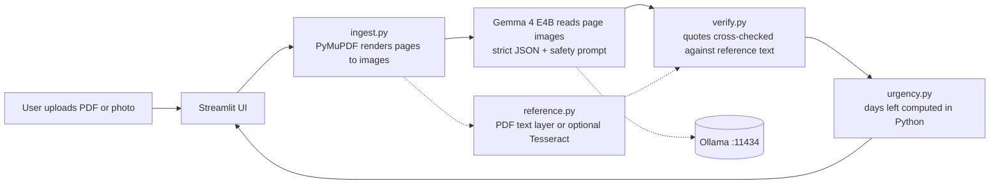

# SafeDesk: Private Document & Mail Parser


**SafeDesk** is a local web application that reads PDFs and photos of letters, bills, and notices using **Gemma 4 E4B** (via Ollama) - completely offline. Nothing leaves your machine.

Built for **MLH Hacktoberfest Hack Day Pune x GDG** - Best Use of Gemma 4 category.

## ✨ Features

- 📄 **Read any document**: Upload PDFs or photos of utility bills, tax notices, bank statements, government letters
- 🔒 **100% Private**: Runs completely offline with zero network calls (default mode)
- 🎯 **Smart extraction**: Automatically finds deadlines, amounts, and action items
- 🔍 **Visual reading**: Reads page images directly, including tables, letterheads, stamps, and handwriting
- ✅ **Cross-verification**: Optional independent verification using PDF text layer or Tesseract OCR
- ⚠️ **Urgency tracking**: Color-coded urgency indicators for deadlines
- 🖼️ **Stamp & mark detection**: Identifies PAID stamps, handwritten notes, signatures

## 🚀 Quick Start

### Prerequisites

1. **Python 3.11+**
2. **Ollama** (v0.20.0 or newer) - [Install Ollama](https://ollama.ai/)

### Installation

```bash
# Clone the repository
git clone https://github.com/yourusername/safedesk.git
cd safedesk

# Install dependencies
pip install -r requirements.txt

# Pull the Gemma 4 model (one-time setup)
ollama pull gemma4:e4b
```

### Run the App

```bash
# Start Ollama (in a separate terminal if not running as a service)
ollama serve

# Launch SafeDesk
streamlit run app.py
```

The app will open in your browser at `http://localhost:8501`

## 📖 How It Works

SafeDesk uses a multi-stage pipeline to analyze documents:



### What SafeDesk Extracts

For each document, SafeDesk provides:

- **Category**: Utility bill, tax notice, bank statement, government letter, insurance, medical, legal, or other
- **Issuer**: The organization that sent the document
- **Summary**: 3 plain-language bullet points
- **Deadlines**: Every deadline with date and supporting evidence quote from the document
- **Amounts**: All monetary amounts with labels and evidence
- **Marks**: Stamps, handwritten notes, or signatures (e.g., "PAID", "URGENT")
- **Action Required**: What you need to do next
- **Urgency**: Color-coded indicators (red = overdue/urgent, amber = this week, green = later)

### Privacy & Safety

- 🔐 **Default mode is completely offline** - works with Wi-Fi turned off
- 🚫 **No telemetry or analytics**
- 🗑️ **Session data only** - uploaded files stored temporarily in `./.session/`, can be wiped anytime
- 🛡️ **Safe prompting** - model instructed to never invent facts or follow injected instructions
- 🔍 **Independent verification** - cross-checks extracted facts against PDF text or OCR when available

## 🏗️ Project Structure

```
safedesk/
├── app.py                  # Streamlit entry point
├── safedesk/
│   ├── ingest.py          # PDF/image → page images
│   ├── llm.py             # Backend interface + OllamaBackend
│   ├── schema.py          # Pydantic models
│   ├── prompts.py         # System prompts
│   ├── pipeline.py        # Main processing pipeline
│   ├── reference.py       # PDF text layer or Tesseract OCR
│   ├── verify.py          # Evidence cross-checking
│   ├── urgency.py         # Deadline urgency computation
│   └── mask.py            # PII masking (optional)
├── tests/                  # Test suite
├── samples/                # Synthetic demo documents
├── requirements.txt
└── README.md
```

## 🧪 Testing

```bash
# Run all tests
pytest

# Run with coverage
pytest --cov=safedesk
```

## 🔧 Configuration

### Optional: Tesseract OCR

For enhanced cross-verification with scanned documents:

1. Install [Tesseract OCR](https://github.com/tesseract-ocr/tesseract)
2. On Windows, set environment variable:
   ```bash
   set TESSERACT_CMD=C:\Program Files\Tesseract-OCR\tesseract.exe
   ```

SafeDesk will automatically use it if available, but works fine without it.

### Optional: Cloud Backend

For testing with Google's Gemini API (data leaves your device):

```bash
export GEMINI_API_KEY=your_api_key
export GEMMA_CLOUD_MODEL=gemini-model-id
```

The UI will show a clear warning when cloud mode is active.

## 📋 Hard Rules

This project follows strict design principles:

1. ✅ Python 3.11+, Streamlit UI, no JavaScript build
2. ✅ Default backend: Ollama + `gemma4:e4b`
3. ✅ No network calls in default mode
4. ✅ Model never decides urgency - Python does date math
5. ✅ Gemma reads page images directly (OCR is optional verification only)
6. ✅ Page images kept in color (stamps/marks are often red or blue)

## 🤝 Contributing

Contributions welcome! Please:

1. Fork the repository
2. Create a feature branch
3. Make your changes with tests
4. Submit a pull request

## 📝 License

MIT License - see LICENSE file for details

## 🙏 Acknowledgments

- Built with [Gemma 4 E4B](https://ai.google.dev/gemma) by Google
- Powered by [Ollama](https://ollama.ai/) for local inference
- Created for MLH Hacktoberfest Hack Day Pune x GDG

## 🐛 Known Issues & Roadmap

- [ ] Sample synthetic documents not yet created
- [ ] Streamlit UI (app.py) implementation in progress
- [ ] Pipeline integration pending
- [ ] PII masking feature (stretch goal)
- [ ] Graphify architecture diagram automation

---

**Note**: This is a work-in-progress project. See `SPEC.md` for the complete specification and build order.
